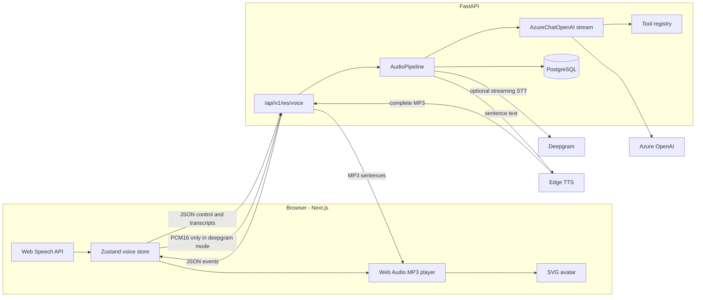

# Voice AI Agent Studio

A local platform for creating, configuring, and talking to custom voice agents. The browser captures speech, a FastAPI service runs the turn, and the Next.js UI plays audio while an SVG avatar follows playback.

With no API keys the process uses a fake streaming language model and short WAV clips, so the loop still runs. Set `LLM_PROVIDER=azure` or `openai`, and `TTS_PROVIDER=edge`, when you want the real providers.

This repository is a personal project. It does not ship with a hosted demo or user counts. The only timings in the repo are from `scripts/bench_latency.py`, and that script says they are synthetic.

## Architecture

The client asks for Deepgram (`stt_mode: "deepgram"`). If `DEEPGRAM_API_KEY` is empty, the server answers `stt_mode: "browser"` and the playground keeps the Web Speech API. With a key, Deepgram is the recognizer and `SpeechStarted` barges in.

LLM tokens and TTS overlap. A producer splits text into sentences (the first piece can be as short as 12 characters) and queues them. A consumer synthesizes the queue while later tokens are still arriving. Edge TTS yields MP3 fragments as they arrive. The fake provider yields complete WAV chunks. The avatar switches to speaking when playback actually starts.



One turn, browser STT (what the playground actually sends):

1. `useSpeechRecognition` emits a final transcript, including a 1500 ms silence fallback.
2. The store sends a `user_transcript` JSON frame and sets the avatar to `thinking`.
3. `AudioPipeline.handle_user_transcript` cancels any in-flight generation and starts `_run_llm_tts_pipeline`.
4. `LLMService.generate_response` streams tokens. If the model requests a tool, the stream pauses, the tool runs, and generation continues (at most 5 rounds).
5. Text is split on `.!?` once the buffer is at least 40 characters. Each sentence is synthesized to a full MP3, then sent as one binary WebSocket frame.
6. `AudioPlayer` decodes that MP3. Playback start sets the avatar to `speaking`; playback end sets it back to `listening`.
7. A `latency_report` frame is sent. User and assistant messages are written to `conversations` / `messages` when the database is up.

Deepgram mode forwards PCM16 to a per-session WebSocket (`interim_results`, `endpointing=300`, `utterance_end_ms=1500`, `vad_events`). A final transcript with `speech_final` starts the same LLM → TTS path. `ListenV1SpeechStarted` is logged and does not cancel playback.

## What is implemented

- Voice WebSocket at `/api/v1/ws/voice`. The client requests Deepgram. Without a key the server falls back to browser captions. `SpeechStarted` and the Interrupt button cancel the LLM task, the TTS consumer, and queued audio.
- Overlapping LLM and TTS. Stage timings (`stt_ms`, `llm_first_token_ms`, `tts_first_byte_ms`, `total_ms`) go out on `latency_report` and are stored on the assistant message.
- Per-session model, temperature, and max tokens. `LLM_PROVIDER` is `azure`, `openai`, or `fake` (`auto` picks Azure, then OpenAI, then fake).
- Memory window, approximate token budget, and an optional extractive summary of dropped turns. A resumed session reloads messages from Postgres. Session fields are written to Redis when `USE_REDIS=true`.
- Tools: empty `enabled_tools` allows nothing; `allow_all: true` allows every registered tool. The executor checks the list again, applies a timeout, and writes `tool_audit_logs`. Weather uses Open-Meteo. The calculator walks an AST.
- Azure, OpenAI, Deepgram, and Edge TTS calls retry with backoff and a timeout. Failures raise `LLMError`, `STTError`, or `TTSError` and the socket gets a recoverable error.
- Agent API: create, list, get, update, delete, duplicate, publish, versions, rollback, analytics, templates, voices. Every update and every publish writes a new snapshot. Rollback copies a snapshot forward. Duplicate and marketplace clone set `slug` and `created_by` when the caller id is a UUID.
- `CallLog` is inserted when the session used a saved agent. `total_calls` increments. Analytics p50/p95 are computed from those turn totals. The calls page and the analytics dashboard read that data.
- JWT register, login, refresh, `/me`. `AUTH_ENABLED=true` requires a Bearer token on agent, call, and analytics routes, and `?token=` on the voice socket. Passwords are bcrypt. Tokens are PyJWT. There is no SHA-256 fallback.
- Health, readiness, and socket metrics.

## What is still not executed

- Knowledge upload does not read a file. Search does not embed. The knowledge screen says coming soon.
- Workflow execute inserts a `running` row and does not walk the graph. The canvas is hidden.
- Evaluations store posted scores. Nothing calls a judge model. Coaching is not implemented. Those screens say coming soon.
- Marketplace publish stores `pending`. Browse returns only `published`. Nothing in the app flips that status. The screen says coming soon.
- `CONFIG_UPDATE` is still only logged. `require_admin` is unused. `top_p` is stored and not sent to the model. Prometheus and OpenTelemetry packages are not wired. The extractive memory note is not a second model call.
- `top_intents` is still an empty list. Ratings on `Agent.avg_rating` are not updated by the voice path.

## Tech stack

| Piece | Choice | Why it is in this repo |
| --- | --- | --- |
| API | FastAPI, uvicorn, orjson | HTTP and WebSocket on one process. Raw ASGI middleware, because `BaseHTTPMiddleware` breaks the WebSocket upgrade (`backend/app/core/middleware.py`). |
| UI | Next.js 15, React 19, TypeScript, Tailwind 4, Zustand | App router pages for agents and the playground. Zustand holds the socket, transcript, and avatar state. |
| STT | Web Speech API by default; Deepgram SDK when requested | Browser STT needs no key. Deepgram is a per-session streaming socket with interim results. |
| LLM | `langchain_openai.AzureChatOpenAI` | Streams tokens and tool calls against an Azure deployment named in the environment. |
| TTS | `edge-tts` | No API key. Output is MP3, decoded in the browser. |
| Data | SQLAlchemy 2 async, asyncpg, Alembic, PostgreSQL 16 | Agent config, versions, and transcripts. Pool is `pool_size=20`, `max_overflow=10`. |
| Cache | Redis 7, off by default | Same method surface as an in-memory store so a single process can run without Redis. |
| Containers | Docker Compose | Postgres with pgvector image, Redis, backend, frontend. |

## Local setup

Prerequisites: Docker, Python 3.12+, Node.js 22+.

```bash
cp .env.example .env
# Fill AZURE_OPENAI_API_KEY and AZURE_OPENAI_ENDPOINT to talk to a model.
# DEEPGRAM_API_KEY is required only for stt_mode=deepgram.
# Leave JWT_SECRET_KEY empty in development.

docker compose up -d postgres redis
cd backend
python -m venv .venv
source .venv/bin/activate
pip install -e ".[dev]"
alembic upgrade head
uvicorn app.main:app --reload --host 0.0.0.0 --port 8000
```

Frontend, second terminal:

```bash
cd frontend
npm install
npm run dev
```

- API docs (development only): http://localhost:8000/docs
- Health: http://localhost:8000/api/v1/health
- UI: http://localhost:3000
- Playground: http://localhost:3000/playground

`make up` starts the compose stack. `make backend`, `make frontend`, `make backend-test`, and `make backend-lint` match the commands above. `make dev` starts Postgres and Redis, then runs migrations.

Postgres in Compose uses `POSTGRES_USER`, `POSTGRES_PASSWORD`, and `POSTGRES_DB` from `.env`, or `voiceai` / `voiceai_dev_password` / `voiceai` if those variables are unset. That password is a local default published in `.env.example`. Do not reuse it. If a volume was created before this change, recreate it with `docker compose down -v` before migrating. The old Compose file used a different user, database name, and password, so an existing volume will not match.

The API process will not start unless `DATABASE_URL` or `POSTGRES_PASSWORD` is set. In `APP_ENV=development`, an empty `JWT_SECRET_KEY` is replaced with a random secret for that process. Staging and production refuse to start without `JWT_SECRET_KEY`.

## Environment

Copy `.env.example`. Names match `backend/app/config.py`.

| Variable | Role |
| --- | --- |
| `APP_ENV` | `development` (default), `staging`, or `production`. Docs URLs are off outside development. |
| `DATABASE_URL` | `postgresql+asyncpg://...` Required if `POSTGRES_PASSWORD` is empty. |
| `POSTGRES_*` | Used to build `DATABASE_URL` when that variable is empty. |
| `USE_REDIS` | `false` uses memory. `true` connects to `REDIS_URL`. |
| `LLM_PROVIDER` | `auto` (default), `azure`, `openai`, or `fake`. |
| `OPENAI_API_KEY`, `OPENAI_MODEL` | Used when the provider is OpenAI. |
| `AZURE_OPENAI_API_KEY`, `AZURE_OPENAI_ENDPOINT`, `AZURE_OPENAI_DEPLOYMENT`, `AZURE_OPENAI_API_VERSION` | Used when the provider is Azure. Per-agent `llm_model` overrides the deployment or model name. |
| `AZURE_OPENAI_MAX_TOKENS`, `AZURE_OPENAI_TEMPERATURE` | Defaults when the agent row does not set them. |
| `LLM_TIMEOUT_S`, `LLM_MAX_RETRIES`, `TTS_TIMEOUT_S`, `TTS_MAX_RETRIES`, `TOOL_TIMEOUT_S` | Retry and timeout budgets. |
| `TTS_PROVIDER` | `auto` uses Edge TTS. `fake` yields WAV clips. |
| `DEEPGRAM_API_KEY`, `DEEPGRAM_MODEL`, `DEEPGRAM_LANGUAGE`, `DEEPGRAM_SAMPLE_RATE` | Required for the Deepgram path. Missing key falls back to the browser. |
| `EDGE_TTS_VOICE`, `EDGE_TTS_RATE`, `EDGE_TTS_VOLUME`, `EDGE_TTS_PITCH` | Defaults when the agent row does not override them. |
| `JWT_SECRET_KEY` | Required outside development. |
| `AUTH_ENABLED` | `false` by default. `true` protects agent, call, analytics, and the voice socket. |
| `INSECURE_SKIP_TLS_VERIFY` | Default `false`. `true` disables certificate checks for Edge TTS and Deepgram. |
| `NEXT_PUBLIC_API_URL`, `NEXT_PUBLIC_WS_URL` | Browser endpoints. |

## API overview

Prefix `/api/v1`.

| Method | Path | Behavior |
| --- | --- | --- |
| GET | `/health`, `/ready`, `/metrics` | Process up, Postgres and Redis checks, socket counters. |
| POST | `/auth/register`, `/auth/login`, `/auth/refresh` | JWT issue and refresh. |
| GET | `/auth/me` | Current token, or a dummy admin when auth is disabled. |
| GET, POST | `/conversations`, `GET/DELETE /conversations/{id}` | List and delete persisted sessions. |
| POST, GET | `/agents` | Create and list. |
| GET | `/agents/templates`, `/agents/voices` | Template flag filter, static voice catalog. |
| GET, PUT, DELETE | `/agents/{id}` | Read, update, delete. Update versions only when `change_note` is sent. |
| POST | `/agents/{id}/duplicate`, `/agents/{id}/publish` | Copy to a new draft, or set status `active`. |
| GET | `/agents/{id}/versions` | Newest snapshot first. |
| POST | `/agents/{id}/rollback/{version}` | Restore that snapshot as a new version. |
| GET | `/agents/{id}/analytics` | Counts from `call_logs` plus the denormalized agent columns. |
| GET | `/tools`, `/tools/{name}` | Registered tool schemas. |
| CRUD | `/workflows`, `POST /workflows/{id}/execute` | Graph storage. Execute inserts a row and does not run the graph. |
| CRUD | `/knowledge` | Metadata. Upload and search are stubs. |
| CRUD-ish | `/marketplace` | Publish, browse, rate, clone. See limitations. |
| POST, GET | `/evaluations`, `/calls/replay` | Store posted scores and timelines. |
| WS | `/ws/voice` | Voice session. |

WebSocket JSON `type` values are defined in `backend/app/schemas/websocket.py`. Binary frames are PCM16 inbound (Deepgram mode) and MP3 outbound.

## Project structure

```
backend/app/
  main.py                 FastAPI factory
  config.py               pydantic-settings
  api/v1/routes/          REST routers
  api/v1/websockets/voice.py
  services/audio/pipeline.py
  services/stt/deepgram_stt.py
  services/llm/chat_service.py
  services/tts/edge_tts_service.py
  services/tools/         registry and built-ins
  services/agent/agent_config.py
  websocket/              connection manager, events
  models/                 SQLAlchemy models
frontend/src/
  app/playground/         voice UI
  app/agents/             studio UI backed by the agent API
  app/analytics/          sums agent list fields
  stores/voice-store.ts
  lib/audio-player.ts
  hooks/use-speech-recognition.ts
docs/case-study-evidence.md
docs/latency-instrumentation.md
```

## Tests

```bash
cd backend && python -m pytest tests/ -q --tb=short
cd backend && python ../scripts/bench_latency.py --turns 20
```

`tests/conftest.py` forces `LLM_PROVIDER=fake` and `TTS_PROVIDER=fake`. The suite covers sentence splitting, tool policy, the AST calculator, memory trim, pipeline ordering, barge-in cancellation, and a WebSocket round trip against Postgres. GitHub Actions runs ruff on the Python files changed from `main`, pytest, and the frontend lint and build.

The benchmark prints p50 time-to-first-audio for a sequential full-buffer simulation and for this pipeline. Both use `asyncio.sleep` inside the fake providers. Those numbers are not Azure or Edge latency. One local run of 8 turns at 5 ms per token and 8 ms per TTS chunk, 3 chunks, reported sequential TTFA p50 102.6 ms, concurrent TTFA p50 40.2 ms, and about 2.2 ms of pipeline overhead past the expected sleeps. Re-run the script before quoting it. The header in the output says the numbers are synthetic.

## Run a real call with your own keys

```bash
cp .env.example .env
```

- Azure: `LLM_PROVIDER=azure`, `AZURE_OPENAI_API_KEY`, `AZURE_OPENAI_ENDPOINT`, `AZURE_OPENAI_DEPLOYMENT`
- OpenAI: `LLM_PROVIDER=openai`, `OPENAI_API_KEY`, `OPENAI_MODEL`
- Speech: `DEEPGRAM_API_KEY` for server STT. Leave it empty to stay on browser captions.
- Voice: `TTS_PROVIDER=edge` (no key). `TTS_PROVIDER=fake` stays offline.

Then start Postgres, run `alembic upgrade head`, and start the two dev servers. Open `/playground`. The typed box works without a microphone. `/playground?agent=<uuid>` is what writes `CallLog` rows.

## Two-minute demo

1. Create an agent, leave allow-all tools on, publish it, and open the playground with that id.
2. Type "What's the weather in Paris?" Tokens show up before the first audio chunk. The avatar switches to speaking when playback starts. The tool row shows `get_weather`.
3. While audio is playing, click Interrupt or start talking. Playback stops and the turn is cancelled.
4. Change the system prompt, save, then roll back to version 1. The prompt returns and the version number increases.
5. End the session and open Analytics. p50 and p95 come from the turns just stored. Calls lists that session.

## Engineering decisions

- TTS used to be awaited inside the token loop, and Edge TTS buffered a whole MP3 before the first byte. Sentences now queue, and chunks are forwarded as they arrive. The synthetic benchmark is how that difference is shown without a live model.
- The first sentence can split at 12 characters. Later sentences still wait for about 40.
- An empty tool list allows nothing. `allow_all: true` is the explicit opt-in. The executor checks the same policy again.
- Temperature, max tokens, and model are read from the agent when the session client is built.
- Auth stays off unless `AUTH_ENABLED=true`. When it is on, agent routes and the voice socket both require a token.
- Screens that are not backed by a real computation say coming soon.

## Debugging stories

- **TTS blocked the token loop.** `_run_llm_tts_pipeline` awaited synthesis before reading the next token, and `synthesize_stream` yielded only after the sentence MP3 was complete. The producer/consumer split and the per-chunk yield are the correction.
- **`BaseHTTPMiddleware` broke the WebSocket upgrade.** Starlette's HTTP middleware wraps the ASGI call in a way that fails the handshake. `backend/app/core/middleware.py` is raw ASGI and ignores non-HTTP scopes. Voice timings are the `latency_report` event, not `x-response-time-ms`.
- **An intercepting proxy broke Edge TTS and Deepgram.** The first upload disabled certificate checks and named a corporate proxy in a comment. Verification stays on unless `INSECURE_SKIP_TLS_VERIFY=true`. The name is gone from the working tree and remains in commit `9e1cbac` because history was not rewritten.

## Roadmap and limitations

- Browser barge-in sends `interrupt` on the first interim result while the agent is speaking. Deepgram barge-in uses `SpeechStarted`. This process does not run its own energy VAD.
- Memory summaries are extractive. They do not call the model.
- Knowledge retrieval, workflow execution, evaluations, coaching, and the marketplace catalog are not live.
- `top_intents` and `Agent.avg_rating` are not filled by the voice path.
- Sockets live in one process. Redis fan-out starts only when `USE_REDIS=true`.
- `ruff check` on the whole tree still reports older findings. CI lints the Python diff.

File and function citations are in [docs/case-study-evidence.md](docs/case-study-evidence.md). The timing plan is in [docs/latency-instrumentation.md](docs/latency-instrumentation.md).
