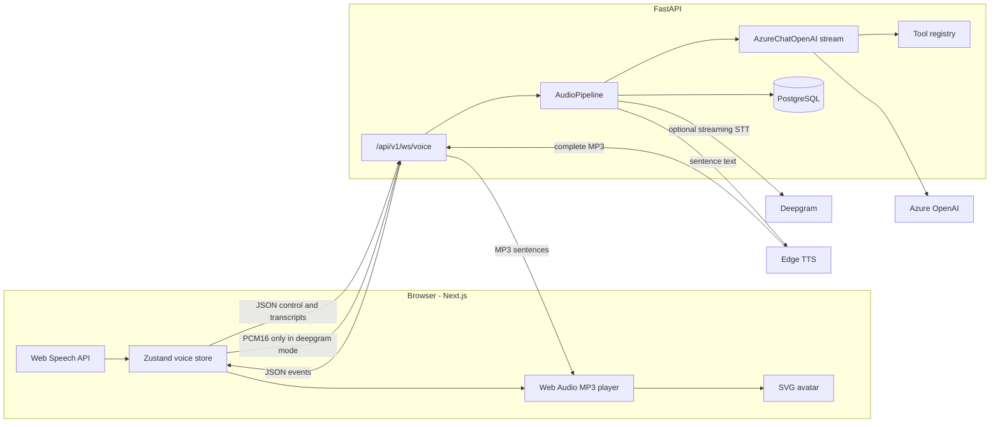

# Voice AI Agent Studio

A local platform for creating, configuring, and talking to custom voice agents. The browser captures speech, a FastAPI service runs the turn (speech-to-text, Azure OpenAI, Edge TTS), and the Next.js UI plays the audio back while an SVG avatar follows playback.

This repository is a personal project. It does not ship with measured latency numbers, a hosted demo, or user counts.

## Architecture

The default session uses the browser Web Speech API. Deepgram is used only when the client sends `stt_mode: "deepgram"`.



One turn, browser STT (what the playground actually sends):

1. `useSpeechRecognition` emits a final transcript, including a 1500 ms silence fallback.
2. The store sends a `user_transcript` JSON frame and sets the avatar to `thinking`.
3. `AudioPipeline.handle_user_transcript` cancels any in-flight generation and starts `_run_llm_tts_pipeline`.
4. `LLMService.generate_response` streams tokens. If the model requests a tool, the stream pauses, the tool runs, and generation continues (at most 5 rounds).
5. Text is split on `.!?` once the buffer is at least 40 characters. Each sentence is synthesized to a full MP3, then sent as one binary WebSocket frame.
6. `AudioPlayer` decodes that MP3. Playback start sets the avatar to `speaking`; playback end sets it back to `listening`.
7. A `latency_report` frame is sent. User and assistant messages are written to `conversations` / `messages` when the database is up.

Deepgram mode forwards PCM16 to a per-session WebSocket (`interim_results`, `endpointing=300`, `utterance_end_ms=1500`, `vad_events`). A final transcript with `speech_final` starts the same LLM → TTS path. `ListenV1SpeechStarted` is logged and does not cancel playback.

## What is implemented

- Voice WebSocket at `/api/v1/ws/voice`: session start/end, ping, interrupt, config update (logged only), binary audio, browser transcripts.
- Streaming Azure OpenAI replies with sentence-level TTS and client playback.
- Explicit interrupt: the `interrupt` frame cancels the LLM task and `AudioPlayer.stop()` clears queued audio. The playground does not call `sendInterrupt`. A new final transcript cancels server generation but does not flush audio already queued in the browser.
- Four in-memory presets (`default`, `concise`, `creative`, `technical`) plus agents loaded from PostgreSQL by UUID or slug.
- Agent HTTP API: create, list, get, update, delete, duplicate, publish, versions, rollback, analytics, templates, voice catalog. The Next.js agent pages call create, list, get, update, publish, delete, versions, rollback, voices, and analytics. Duplicate and templates are API-only.
- Immutable `agent_versions.config_snapshot` JSON. A new row is written on create, on duplicate, on update when `change_note` is set, and on rollback. Rollback copies the snapshot onto the live row and appends a new version. There is no update API for an existing snapshot.
- Built-in tools: `get_current_time`, `get_weather` (fixed sample cities, otherwise a hash of the name), `calculator`.
- Conversation persistence: session row, user message, assistant message with a chunk count and total turn latency.
- Optional Redis. `USE_REDIS=false` (the default) uses an in-process store. Redis pub/sub fan-out starts only when Redis is enabled.
- JWT register, login, refresh, and `/me`. `AUTH_ENABLED` defaults to false, and agent, conversation, and voice routes do not require a token.
- Health, readiness, and WebSocket connection metrics.
- Alembic migrations for the tables in `backend/app/models`.

## What is stored but not executed

These routes and screens exist. They are not part of the live voice path.

- `memory_config` is saved on the agent and edited in the UI. `LLMService.trim_history` is never called. Nothing summarizes history or reads `max_context_tokens`.
- Per-agent `llm_model`, `temperature`, `max_tokens`, and `top_p` are stored. The Azure client uses the process-wide settings in `config.py`.
- `CallLog` is read by analytics. Nothing in this repo inserts a row or increments `Agent.total_calls`. Analytics returns `latency_p50_ms: 0`, `latency_p95_ms: 0`, and `top_intents: []`.
- Knowledge bases can be created. Document upload writes a placeholder row named `uploaded_document.pdf` and does not read a file. Search returns stored chunks with synthetic scores. Embeddings are a JSONB column. `pgvector` is created in `infra/postgres/init.sql` and is not queried.
- Workflow CRUD stores a graph. `POST /workflows/{id}/execute` inserts a row with status `running` and does not run nodes. The workflow page is local React state and does not call the API.
- Evaluations and call replays store the JSON you post. There is no judge model call. The evaluations, calls, coaching, knowledge, and marketplace pages render hardcoded arrays.
- Marketplace publish, browse, rate, and clone hit the database. Clone does not set `slug` (the column is non-null) and reads `agent.user_id`, which is not a field on `Agent` (`created_by` is). Publishing sets status `pending`, while browse only returns `published`.
- `CONFIG_UPDATE` on the socket is logged. The comment in `voice.py` marks it TODO.
- `require_admin` is unused. `RateLimitError` is unused. Prometheus and OpenTelemetry packages are dependencies and are not wired up.
- Password hashing falls back to unsalted SHA-256 if `bcrypt` is not installed. `pyproject.toml` does not depend on `bcrypt` or PyJWT; `security.py` tries `bcrypt`, then PyJWT, then `python-jose`.

## Tech stack

| Piece | Choice | Why it is in this repo |
| --- | --- | --- |
| API | FastAPI, uvicorn, orjson | HTTP and WebSocket on one process. Raw ASGI middleware, because `BaseHTTPMiddleware` breaks the WebSocket upgrade (`backend/app/core/middleware.py`). |
| UI | Next.js 15, React 19, TypeScript, Tailwind 4, Zustand | App router pages for agents and the playground. Zustand holds the socket, transcript, and avatar state. |
| STT | Web Speech API by default; Deepgram SDK when requested | Browser STT needs no key. Deepgram is a per-session streaming socket with interim results. |
| LLM | `langchain_openai.AzureChatOpenAI` | Streams tokens and tool calls against an Azure deployment named in the environment. |
| TTS | `edge-tts` | No API key. Output is MP3, decoded in the browser. |
| Data | SQLAlchemy 2 async, asyncpg, Alembic, PostgreSQL 16 | Agent config, versions, and transcripts. Pool is `pool_size=20`, `max_overflow=10`. |
| Cache | Redis 7, off by default | Same method surface as an in-memory store so a single process can run without Redis. |
| Containers | Docker Compose | Postgres with pgvector image, Redis, backend, frontend. |

## Local setup

Prerequisites: Docker, Python 3.12+, Node.js 22+.

```bash
cp .env.example .env
# Fill AZURE_OPENAI_API_KEY and AZURE_OPENAI_ENDPOINT to talk to a model.
# DEEPGRAM_API_KEY is required only for stt_mode=deepgram.
# Leave JWT_SECRET_KEY empty in development.

docker compose up -d postgres redis
cd backend
python -m venv .venv
source .venv/bin/activate
pip install -e ".[dev]"
alembic upgrade head
uvicorn app.main:app --reload --host 0.0.0.0 --port 8000
```

Frontend, second terminal:

```bash
cd frontend
npm install
npm run dev
```

- API docs (development only): http://localhost:8000/docs
- Health: http://localhost:8000/api/v1/health
- UI: http://localhost:3000
- Playground: http://localhost:3000/playground

`make up` starts the compose stack. `make backend`, `make frontend`, `make backend-test`, and `make backend-lint` match the commands above. `make dev` starts Postgres and Redis, then runs migrations.

Postgres in Compose uses `POSTGRES_USER`, `POSTGRES_PASSWORD`, and `POSTGRES_DB` from `.env`, or `voiceai` / `voiceai_dev_password` / `voiceai` if those variables are unset. That password is a local default published in `.env.example`. Do not reuse it. If a volume was created before this change, recreate it with `docker compose down -v` before migrating. The old Compose file used a different user, database name, and password, so an existing volume will not match.

The API process will not start unless `DATABASE_URL` or `POSTGRES_PASSWORD` is set. In `APP_ENV=development`, an empty `JWT_SECRET_KEY` is replaced with a random secret for that process. Staging and production refuse to start without `JWT_SECRET_KEY`.

## Environment

Copy `.env.example`. Names match `backend/app/config.py`.

| Variable | Role |
| --- | --- |
| `APP_ENV` | `development` (default), `staging`, or `production`. Docs URLs are off outside development. |
| `DATABASE_URL` | `postgresql+asyncpg://...` Required if `POSTGRES_PASSWORD` is empty. |
| `POSTGRES_*` | Used to build `DATABASE_URL` when that variable is empty. |
| `USE_REDIS` | `false` uses memory. `true` connects to `REDIS_URL`. |
| `AZURE_OPENAI_API_KEY`, `AZURE_OPENAI_ENDPOINT`, `AZURE_OPENAI_DEPLOYMENT`, `AZURE_OPENAI_API_VERSION` | LLM client. Empty key means the voice turn fails when a transcript arrives. |
| `AZURE_OPENAI_MAX_TOKENS`, `AZURE_OPENAI_TEMPERATURE` | Process-wide generation settings. |
| `DEEPGRAM_API_KEY`, `DEEPGRAM_MODEL`, `DEEPGRAM_LANGUAGE`, `DEEPGRAM_SAMPLE_RATE` | Used only for Deepgram sessions. |
| `EDGE_TTS_VOICE`, `EDGE_TTS_RATE`, `EDGE_TTS_VOLUME`, `EDGE_TTS_PITCH` | Defaults when the agent row does not override them. |
| `JWT_SECRET_KEY` | Required outside development. |
| `AUTH_ENABLED` | `false` makes `/api/v1/auth/me` return a dummy admin. Other routes do not check it. |
| `INSECURE_SKIP_TLS_VERIFY` | Default `false`. `true` disables certificate checks for Edge TTS and Deepgram. |
| `NEXT_PUBLIC_API_URL`, `NEXT_PUBLIC_WS_URL` | Browser endpoints. |

## API overview

Prefix `/api/v1`.

| Method | Path | Behavior |
| --- | --- | --- |
| GET | `/health`, `/ready`, `/metrics` | Process up, Postgres and Redis checks, socket counters. |
| POST | `/auth/register`, `/auth/login`, `/auth/refresh` | JWT issue and refresh. |
| GET | `/auth/me` | Current token, or a dummy admin when auth is disabled. |
| GET, POST | `/conversations`, `GET/DELETE /conversations/{id}` | List and delete persisted sessions. |
| POST, GET | `/agents` | Create and list. |
| GET | `/agents/templates`, `/agents/voices` | Template flag filter, static voice catalog. |
| GET, PUT, DELETE | `/agents/{id}` | Read, update, delete. Update versions only when `change_note` is sent. |
| POST | `/agents/{id}/duplicate`, `/agents/{id}/publish` | Copy to a new draft, or set status `active`. |
| GET | `/agents/{id}/versions` | Newest snapshot first. |
| POST | `/agents/{id}/rollback/{version}` | Restore that snapshot as a new version. |
| GET | `/agents/{id}/analytics` | Counts from `call_logs` plus the denormalized agent columns. |
| GET | `/tools`, `/tools/{name}` | Registered tool schemas. |
| CRUD | `/workflows`, `POST /workflows/{id}/execute` | Graph storage. Execute inserts a row and does not run the graph. |
| CRUD | `/knowledge` | Metadata. Upload and search are stubs. |
| CRUD-ish | `/marketplace` | Publish, browse, rate, clone. See limitations. |
| POST, GET | `/evaluations`, `/calls/replay` | Store posted scores and timelines. |
| WS | `/ws/voice` | Voice session. |

WebSocket JSON `type` values are defined in `backend/app/schemas/websocket.py`. Binary frames are PCM16 inbound (Deepgram mode) and MP3 outbound.

## Project structure

```
backend/app/
  main.py                 FastAPI factory
  config.py               pydantic-settings
  api/v1/routes/          REST routers
  api/v1/websockets/voice.py
  services/audio/pipeline.py
  services/stt/deepgram_stt.py
  services/llm/chat_service.py
  services/tts/edge_tts_service.py
  services/tools/         registry and built-ins
  services/agent/agent_config.py
  websocket/              connection manager, events
  models/                 SQLAlchemy models
frontend/src/
  app/playground/         voice UI
  app/agents/             studio UI backed by the agent API
  app/analytics/          sums agent list fields
  stores/voice-store.ts
  lib/audio-player.ts
  hooks/use-speech-recognition.ts
docs/case-study-evidence.md
docs/latency-instrumentation.md
```

## Tests

```bash
cd backend && python -m pytest tests/ -v --tb=short
cd backend && ruff check . && ruff format --check .
```

Present today:

- `tests/test_health.py` checks `/api/v1/health` and `/api/v1/metrics`.
- `tests/test_websocket_manager.py` checks connect, replace, cancel, and metrics.
- `tests/test_config.py` checks that the database credential and production JWT secret are required.

There is no frontend test runner, no Playwright suite, and no test that drives STT, the LLM, or TTS. Those calls need network and API keys.

## Roadmap and limitations

Known gaps, in the order they affect a real conversation:

- TTS is awaited inside the token loop, and each sentence is a full MP3 before the first byte is sent. See [docs/latency-instrumentation.md](docs/latency-instrumentation.md).
- The playground never sends `interrupt`, and Deepgram speech-start does not barge in.
- Agent LLM knobs and memory policy are not applied at runtime.
- Analytics call metrics are not written by the pipeline.
- Knowledge search, workflow execution, and LLM-as-judge are storage or UI only.
- Auth does not cover the agent or voice APIs. `AUTH_ENABLED=false` is the default.
- TLS verification can be turned off with `INSECURE_SKIP_TLS_VERIFY`. Leave it false.
- One API process holds sockets in memory. Redis fan-out exists only when `USE_REDIS=true`.

A factual map of what the code does, with file and function citations, is in [docs/case-study-evidence.md](docs/case-study-evidence.md).
